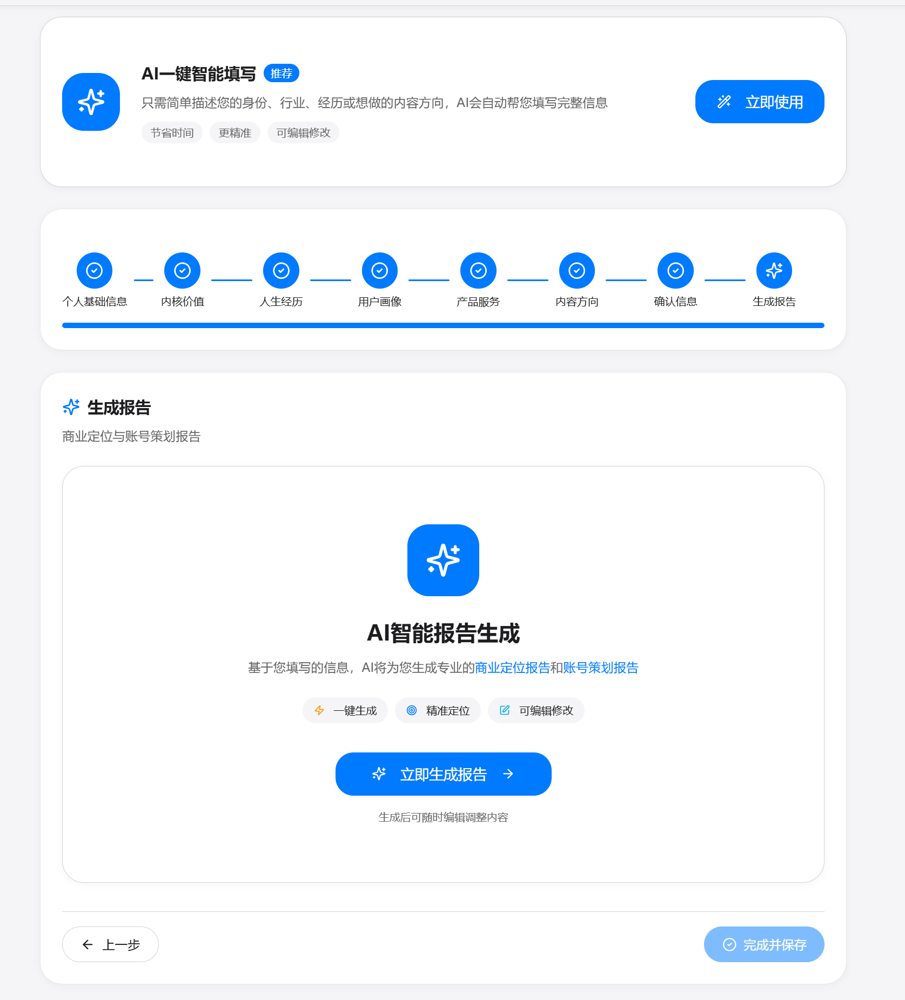
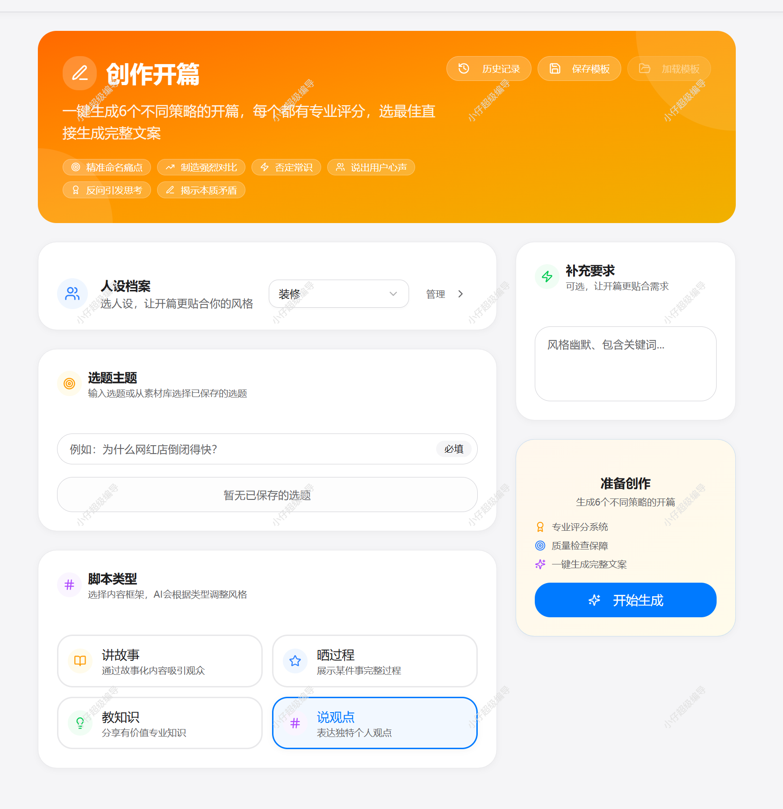

# 超级编导 · AI 短视频创作工作台

本项目即此前以「小仔」名称整理的开源版本，仓库沿用 `xiaozi-ai`。现有封面与部分界面仍保留原名称。

### 从客户资料到内容选题，再到拍摄脚本，把短视频创作前期的工作放在一起。

做一个账号，往往要同时处理客户需求、产品卖点、参考视频、选题和脚本。资料分散在聊天记录、表格和不同的 AI 对话里，每次开始写内容，都要重新整理背景。

**超级编导将客户与产品资料、选题与脚本生成、参考视频分析和素材管理放进同一个 Web 项目。** 你可以阅读这些模块的实现，接入自己的数据库与 AI 服务，再围绕自己的内容业务继续开发。

[操作演示](#操作演示) · [界面预览](#界面预览) · [功能模块](#功能模块) · [使用场景](#使用场景) · [安装与配置](#安装与配置) · [当前范围与限制](#当前范围与限制) · [贡献指南](CONTRIBUTING.md)

> 本项目公开的是源码，不提供原作者的数据库、客户资料、账号、密钥或在线服务。AI 和视频分析等能力需自行配置对应服务；部分模块仍在完善。

## 操作演示

**先看实际操作，再看下面的界面细节。**

[▶ 点击观看操作录屏（Cap）](https://cap.so/s/65d787m0hvnp2k2)

录屏为维护者提供并确认可公开分享的历史版本演示，点击链接前往 Cap 播放。录屏与截图中的旧名称、页面和功能状态可能与当前源码不同；演示不代表当前开源版本已完成数据库、AI 服务或浏览器端到端验收。

## 界面预览

以下为此前版本的真实界面截图，用于展示产品界面与操作组织；不代表当前开源版本的外部服务已完成联调，实际效果以当前源码和自行配置的服务为准。

### IP 定位与账号规划

通过分步填写组织个人背景、用户画像、产品服务与内容方向，进入定位及账号策划报告的生成入口。此图展示操作界面，不是已生成报告。



### 开篇与脚本创作

选择人设、填写选题、补充要求并选择脚本类型，组织开篇创作的输入条件。图中的评分与生成入口属于历史界面展示，结果质量及链路需自行验证。



## 功能模块

| 模块 | 可以围绕它完成什么工作 |
| --- | --- |
| 客户与账号资料 | 整理客户背景、业务信息与内容需求，为后续策划保留上下文 |
| 产品资料与定位 | 管理产品信息、卖点和用户痛点，为内容创作准备输入 |
| 选题与脚本 | 围绕主题、行业与客户信息组织选题、开场、口播及对话脚本 |
| 参考视频分析 | 通过已配置的视频与 AI 服务分析参考内容，辅助拆解创作思路 |
| 广告文案 | 提供信息流、千川相关文案与脚本模块代码，供按业务需求调整 |
| 素材与创作记录 | 整理素材及创作过程中的内容，方便回看和后续修改 |

表格描述的是仓库中的模块和用途，不代表所有外部服务链路已完成验收。具体可用范围见下方说明。

## 使用场景

**给客户做内容策划。** 先整理客户背景和产品资料，再进入选题与脚本模块，减少在多个文档和对话中反复查找背景。

**为一个产品准备多种内容表达。** 基于同一份产品资料，尝试口播、对话或广告文案等不同方向，再由创作者筛选和修改。

**研究 AI 内容工具如何实现。** 从前端页面、API、会话权限到数据库结构，阅读一个包含实际业务模块的 Next.js 项目，或选取其中的模块用于自己的二次开发。

## 一次内容策划可以怎样组织

1. 建立客户资料，记录业务背景和内容需求。
2. 补充产品信息，整理卖点、目标用户与痛点。
3. 按需分析参考视频，形成选题方向。
4. 使用选题与脚本模块起草内容，再人工校对、改写和筛选。
5. 将需要保留的资料与内容整理到素材和创作记录中。

这是模块的使用组织方式；当前没有承诺全程自动执行、自动剪辑成片或自动发布。

## 技术组成

| 层次 | 实现 |
| --- | --- |
| Web 应用 | Next.js App Router、React、TypeScript |
| 界面 | Tailwind CSS、Radix UI 相关组件 |
| 数据 | PostgreSQL / Supabase 接入与初始化脚本 |
| AI 接入 | Coze SDK 及可配置的服务网关 |
| 视频相关能力 | 对应视频服务接口；部分处理依赖 FFmpeg 环境 |
| 本地质量检查 | 自动测试、TypeScript、ESLint、源码敏感信息扫描 |

模型、数据库、存储和视频服务需要各自的配置与授权。源码免费开放不代表第三方服务免费。

## 开始之前

- 当前锁定 Next.js 16.1.1，尚未完成安全版本升级。部署前先联网核对最新安全公告、升级相关依赖并重新测试，见 [依赖安全说明](docs/DEPENDENCY_SECURITY.md)。
- 只有 `.env.example` 空配置模板；实际值放在自己的 `.env.local` 或部署平台秘密变量中，不能提交仓库。
- 不要将真实客户资料作为示例数据、问题附件或测试样本。

## 安装与配置

需要 Node.js 20.9 及以上和 pnpm 9.0.0；建议使用兼容的当前 Node.js LTS。完整步骤见 [自行配置与部署](docs/SELF_HOSTING.md)。

```bash
corepack pnpm install --frozen-lockfile --ignore-scripts
cp .env.example .env.local
```

Windows PowerShell 使用 `Copy-Item .env.example .env.local`。安装后先完成依赖安全升级、审计与回归，再启动服务。升级示例及检查命令在部署文档中；不要只改 package.json 而保留旧锁文件。

配置自己的数据库和 AI 网关。数据库初始化脚本只供**新建空测试库**使用，不是旧生产库迁移工具。表结构、权限与操作步骤见 [数据库初始化](docs/DATABASE_INITIALIZATION.md)。不要把服务端数据库私钥放在 `NEXT_PUBLIC_` 变量中。

数据库配置好后可初始化管理员：

```bash
corepack pnpm bootstrap-admin
```

默认用户名为 `admin`，**没有统一默认密码**。未提供 `ADMIN_PASSWORD` 时，首次创建成功后显示一次独立随机强密码；已有账号不被覆盖。

## 开发与检查

```bash
corepack pnpm dev
corepack pnpm test
corepack pnpm ts-check
corepack pnpm lint:build
corepack pnpm build
node scripts/scan-public-source.cjs
```

本地访问 `http://localhost:5000`。Windows 如遇构建目录并发创建冲突，可使用 `corepack pnpm build:windows`。依赖服务必须使用自己的配置；缺少配置时接口会明确拒绝，不会自动恢复原项目凭据。

## 当前范围与限制

- 具备脚本/选题、视频分析、客户/产品/素材管理等代码；实际可用性取决于配置的数据库、AI、存储和视频服务。
- 无可信原子流水的旧兑换、分佣、充值/分配、结算、奖励、自动执行及自动退款已明确停用；不能直接接入真实资金。
- AI 请求额度限制是进程内实现，多实例部署需要共享额度服务。
- 仓库保存了 2026-10-15 的 324 项自动测试、TypeScript 检查和 Windows 兼容生产构建通过记录；这是历史验证记录，不代表当前提交的 GitHub Actions / CI 已验证通过。模拟边界测试不代替真实数据库、AI 和浏览器端到端验收。
- 完整状态、验证范围及暂不可用功能见 [准备状态](docs/PREPUBLICATION_STATUS.md) 和 [验证记录](docs/VALIDATION_RESULTS.json)。

## 文档

- [自行配置与部署](docs/SELF_HOSTING.md)
- [数据库初始化](docs/DATABASE_INITIALIZATION.md)
- [依赖安全说明](docs/DEPENDENCY_SECURITY.md)
- [安全说明](SECURITY.md)
- [贡献指南](CONTRIBUTING.md)
- [素材来源与处理](docs/ASSET_PROVENANCE.md)
- [第三方许可证声明](THIRD_PARTY_NOTICES.md)

## 许可证

项目自有、且有权许可的贡献采用 [MIT](LICENSE)。第三方依赖保留各自许可证；用户上传、外部服务内容和运行时数据不因本许可证而获准再分发。原有代码及保留材料的再分发权由维护者确认。
